# PREPLINE architecture

## Data flow

```mermaid
flowchart LR
  subgraph inputs[Inputs]
    PDF[Syllabus PDFs<br/>data/raw/syllabi<br/>+ transcriptions]
    INT[Interview reports<br/>data/processed/&lt;target&gt;/<br/>reports.csv, questions.csv]
    TAX[taxonomy_v1.0.json]
    CFG[config/scoring_v1.2.json<br/>targets.json]
  end

  subgraph pipeline[pipeline/]
    SP[syllabus_parser<br/>courses → modules,<br/>depth signals]
    IP[interview_parser<br/>filter + dedupe]
    KA[keyword_abstraction<br/>pass 1: concepts]
    EM[embeddings<br/>MiniLM, τ = 0.50]
    TM[taxonomy_mapper<br/>pass 2: topic ids,<br/>60/40 credit]
    SC[scoring<br/>Coverage, I&#40;t&#41;, S_comp,<br/>PriorityGap]
    UL[unmapped_terms_logger<br/>taxonomy_versioning]
  end

  subgraph evaluation[evaluation/ — offline runs]
    RUN[run_all_targets<br/>→ results/*_v1.2_*.json]
    TOP[export_topic_tables<br/>→ results/topics]
    STU[export_study_modules<br/>→ results/study]
    BEN[benchmark/run_benchmark<br/>→ results/benchmark]
    RET[retro_validation<br/>→ results/validation]
    PIL[pilot/analyze_pilot<br/>Google Form CSV → results/pilot]
  end

  subgraph backend[backend/ — FastAPI]
    R[routes.py<br/>upload + pipeline/run]
    D[dashboard.py<br/>read-only results]
    S[study.py<br/>/study/&#123;target&#125;]
    P[report.py<br/>/report/&#123;target&#125; PDF]
  end

  WEB[dashboard/web<br/>React + Vite<br/>Overview, Compare, Topics,<br/>Confidence, Benchmark, Methodology]

  PDF --> SP --> KA
  INT --> IP --> KA
  KA --> EM --> TM --> SC
  TAX --> TM
  CFG --> SC
  TM --> UL
  SC --> RUN
  SC --> TOP
  SP --> STU
  TM --> BEN
  SC --> RET
  RUN & TOP & STU & BEN & RET & PIL --> D
  D --> S --> P
  LINKS[config/practice_links.json<br/>WebFetch-verified] --> S
  SC --> R
  D & S & P & R --> WEB
```

Scores are computed **offline** and saved with their versions (results v1.2, taxonomy v1.0, config v1.2); the dashboard
endpoints only read those files, so opening the dashboard never changes a number. `routes.py` is the one live path: it
scores an uploaded syllabus PDF against a configured target.

## Code graph (Graphify, AST pass)

Built with [graphify](https://github.com/safishamsi/graphify) on 2026-10-23 over `backend/`, `pipeline/`,
`evaluation/` and `dashboard/web/src/` (90 code files, structural extraction only, no LLM): **1,098 nodes,
2,753 edges, 49 communities**. The graph itself is not committed; rebuild it with `/graphify` on those folders.

Most connected functions (the core abstractions):

| Function | Edges | Role |
|---|---|---|
| `load_scoring_config()` | 31 | Every frozen parameter (τ, γ, depth references, MIN_REPORTS, core courses) |
| `segment_courses()` | 30 | Splits the syllabus text into courses |
| `parse_syllabus_pdfs()` | 29 | Combined syllabus parse (PDF text layer + transcriptions) |
| `calculate_topic_importance()` | 28 | I(t) per report, max-capped |
| `load_targets()` | 27 | The configured company/role targets |
| `parse_syllabus_pdf()` | 27 | Single-PDF parse |
| `calculate_syllabus_coverage()` | 26 | C(t), D(t), Coverage(t), inheritance to granular topics |
| `parse_course_modules()` | 25 | Course → modules / lab experiments with depth signals |
| `filter_questions()` | 24 | Drops behavioural, vague and link-only questions |

The largest communities match the folders above: the dashboard UI (116 nodes), benchmark labelling and splits (79),
taxonomy versioning and unmapped terms (56), the pilot kit (56), scoring with the interview parser (49) and the
backend routes with config (43). Cohesion is low (0.06–0.18) because the tests in `evaluation/` link to nearly every
module.

## Where to change what

| Change | Files | Rule |
|---|---|---|
| Add a company/role | `data/processed/<id>/`, `config/targets.json` | `docs/ADDING_A_COMPANY.md`; other targets are unaffected |
| Scoring parameter | new `config/scoring_vX.json` | Frozen; never overwrite old results |
| Taxonomy | new `taxonomy_vX.json` | `pipeline/taxonomy_versioning.py` |
| Dashboard data | `evaluation/export_*.py` | Writes new files only; never overwrites |
| Practice links | `config/practice_links.json` | Re-verify every URL; update `verified_on` |
