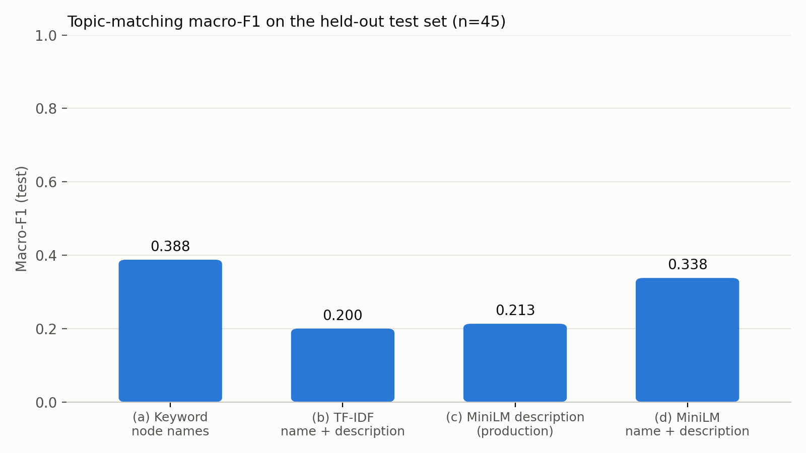

# Matcher benchmark v1.0 (Phase 13)

Generated by `evaluation/benchmark/run_benchmark.py` on 2026-10-22. Gold labels `evaluation/benchmark/labels_v1.0.csv`, split `evaluation/benchmark/splits_v1.0.csv` (seed 20261022), taxonomy v1.0. Production config and τ were not changed.

Each method predicts the top-1 node of the allowed type (syllabus → high_level_concept, interview → granular_skill) if its score clears the threshold, else `none`. Thresholds were swept on **dev** only (0.30–0.70, step 0.05), checked on **val**, and **test** was evaluated with those thresholds and never used for a choice (it was computed twice by accident, with identical numbers; see Limitations).

| Split | Syllabus rows (courses) | Interview rows (reports) |
|---|---|---|
| dev | 136 (BCSE102, BCSE202, BCSE205, BCSE301, BCSE302, BCSE303, BCSE304, BCSE307, BCSE308, BMAT205) | 31 (AMZ001, AMZ002, AMZ003, AMZ005, AMZ007, AMZ008, AMZ009, AMZ014, AMZ018, AMZ019, AMZ020, AMZ021, AMZ022) |
| val | 30 (BCSE101, BCSE103, BCSE305, BCSE306) | 5 (AMZ004, AMZ006) |
| test | 35 (BCSE204, BCSE309) | 10 (AMZ013, AMZ016, AMZ017) |

## Test set (held out; thresholds from dev)

| Method | Threshold (from dev) | Accuracy | Macro-P | Macro-R | Macro-F1 | Syllabus acc. | Interview acc. |
|---|---|---|---|---|---|---|---|
| (a) keyword match on node names | 0.40 | 0.644 (29/45) | 0.430 | 0.375 | **0.388** | 0.629 (22/35) | 0.700 (7/10) |
| (b) TF-IDF over node name + description | 0.30 | 0.533 (24/45) | 0.212 | 0.203 | **0.200** | 0.486 (17/35) | 0.700 (7/10) |
| (c) MiniLM, node descriptions only (current production) | 0.55 | 0.533 (24/45) | 0.237 | 0.219 | **0.213** | 0.514 (18/35) | 0.600 (6/10) |
| (d) MiniLM, node name + description | 0.40 | 0.489 (22/45) | 0.368 | 0.324 | **0.338** | 0.486 (17/35) | 0.500 (5/10) |

## Dev and val at the chosen threshold

| Method | Threshold | Dev acc. | Dev macro-F1 | Val acc. | Val macro-F1 |
|---|---|---|---|---|---|
| (a) keyword match on node names | 0.40 | 0.497 (83/167) | 0.439 | 0.343 (12/35) | 0.084 |
| (b) TF-IDF over node name + description | 0.30 | 0.593 (99/167) | 0.403 | 0.571 (20/35) | 0.107 |
| (c) MiniLM, node descriptions only (current production) | 0.55 | 0.587 (98/167) | 0.314 | 0.714 (25/35) | 0.143 |
| (d) MiniLM, node name + description | 0.40 | 0.515 (86/167) | 0.406 | 0.257 (9/35) | 0.125 |

## Test accuracy by gold domain

| Method | cn | dsa | none |
|---|---|---|---|
| (a) keyword match on node names | 0.000 (0/9) | 0.643 (9/14) | 0.909 (20/22) |
| (b) TF-IDF over node name + description | 0.000 (0/9) | 0.214 (3/14) | 0.955 (21/22) |
| (c) MiniLM, node descriptions only (current production) | 0.000 (0/9) | 0.214 (3/14) | 0.955 (21/22) |
| (d) MiniLM, node name + description | 0.111 (1/9) | 0.643 (9/14) | 0.545 (12/22) |

## Recommendation (production config and τ unchanged)

Keep the production matcher (minilm_desc, τ unchanged): it has the best val macro-F1. Dev and test favour keyword instead, so the evidence conflicts and is too small to justify a change; re-run with a larger val set before deciding. Macro-F1 per method: keyword: dev 0.439, val 0.084, test 0.388; tfidf: dev 0.403, val 0.107, test 0.200; minilm_desc: dev 0.314, val 0.143, test 0.213; minilm_name_desc: dev 0.406, val 0.125, test 0.338.

## Limitations

- **Small val and test.** Val is 35 items (4 courses, 2 reports) and test 45 items (2 courses, 3 reports); one item is 2-3 percentage points, and the scores depend on which courses landed in each split. Macro-F1 over ~20 labels with a handful of items each is noisy; read counts, not only percentages.
- **Gold labels are LLM-drafted, then partly human-adjudicated.** Kappa 0.812 is agreement between two independent LLM labellers (a Claude draft vs a fresh Claude subagent that saw only the item text, the guide and the cheat sheet). The 56 rows where they disagreed or either was unsure were adjudicated by the human owner (rules R1-R5 plus 8 individual decisions); the other 191 rows are LLM cross-checked only, not individually human-reviewed (see evaluation/benchmark/ADJUDICATION.md).
- **Gold v1.0 is frozen at 25 courses.** BCSE203E Web Programming was supplied after the gold labels were built; its units are scored in the v1.2 results but are not in labels_v1.0.csv or the split.
- **Many gold labels are `none`** (courses outside the taxonomy, R1-R3), so a matcher that predicts `none` often scores well on accuracy; macro-F1 is the main metric for that reason.
- **Top-1 only.** The production pipeline gives credit to every node above τ (60/40 split); this benchmark scores only the top-1 node against the gold primary. Secondaries are not scored.
- **Methods (a) and (b) see the raw text; (c) and (d) see the two-pass RAKE concepts**, as production does.
- **The test split was computed twice, not once.** A mistyped command after the first run re-ran the script; it reproduced the same test numbers and its write was refused. No choice was made from either computation. The results commit message (a1b6c3c) says "test scored once"; that is inaccurate for this reason.

