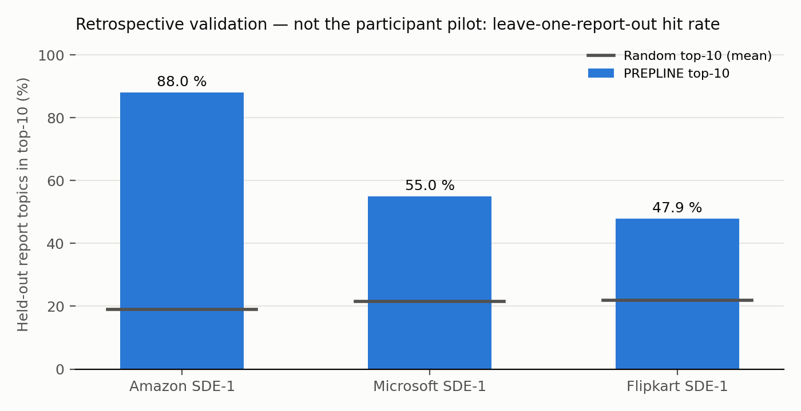

# Retrospective validation — not the participant pilot

Generated by `evaluation/retro_validation.py` on 2026-10-22. Leave-one-report-out on the collected interview reports: for each report, I(t) is recomputed from the other reports with the frozen scoring config v1.2, and its top-10 topics are compared with the topics the held-out report's questions map to. Baseline: the same number of topics drawn at random from the 46 interview skills (1000 draws, seed 20261023). This is **not** the participant pilot (Phase 16): it reuses the same public reports PREPLINE is built from.

| Company | Reports (scored folds) | PREPLINE top-10 hit rate | Random baseline (95 % of draws) |
|---|---|---|---|
| Amazon SDE-1 | 18 (10) | 88.0 % | 18.9 % (4.0 %–37.5 %) |
| Microsoft SDE-1 | 15 (10) | 55.0 % | 21.5 % (5.8 %–40.0 %) |
| Flipkart SDE-1 | 17 (8) | 47.9 % | 21.9 % (4.2 %–47.9 %) |

Reading it: the hit rate says how often a new report's topics were already among the most important topics of the other reports. Folds where the held-out report maps to no topic are skipped (counted in the table).

Limitations: small samples (15–18 reports per company); one source site, so reports share writing style; the held-out topics come from the same matcher as the top-10 (mapping errors cancel rather than show); the random interval describes the draws, not a significance test.

